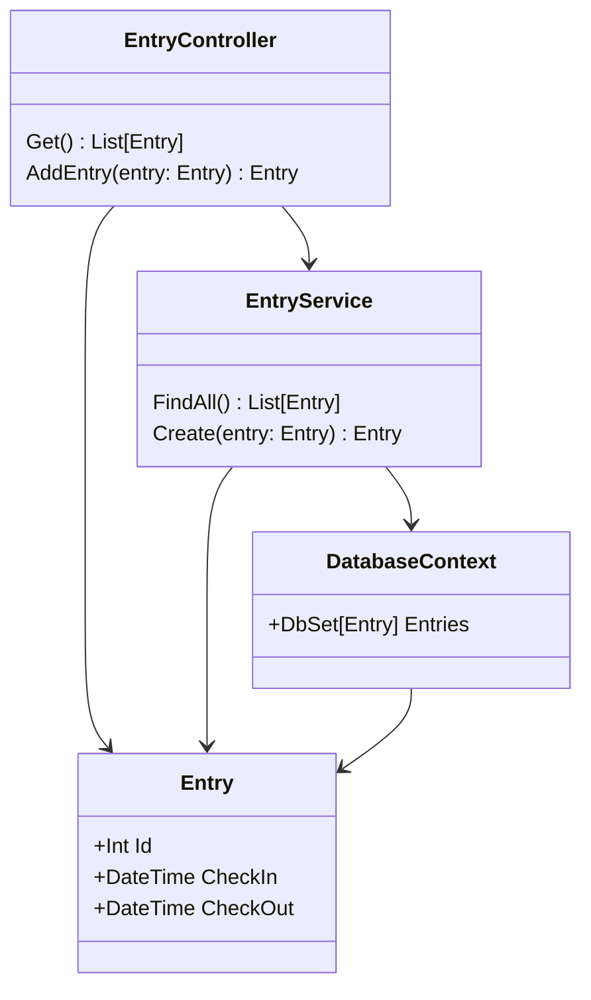
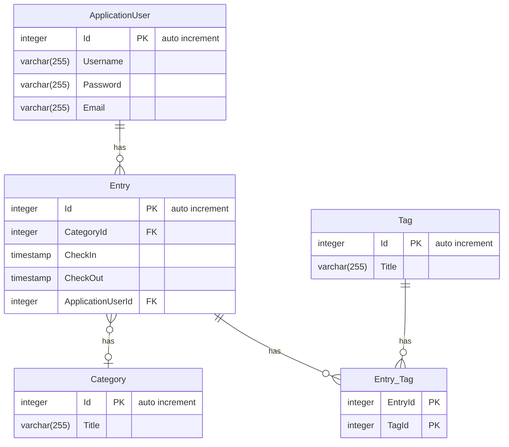
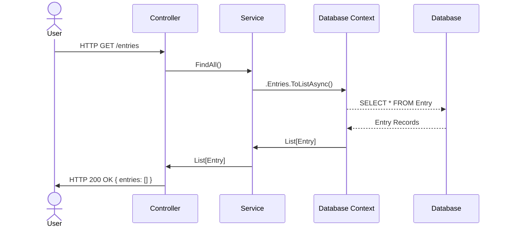
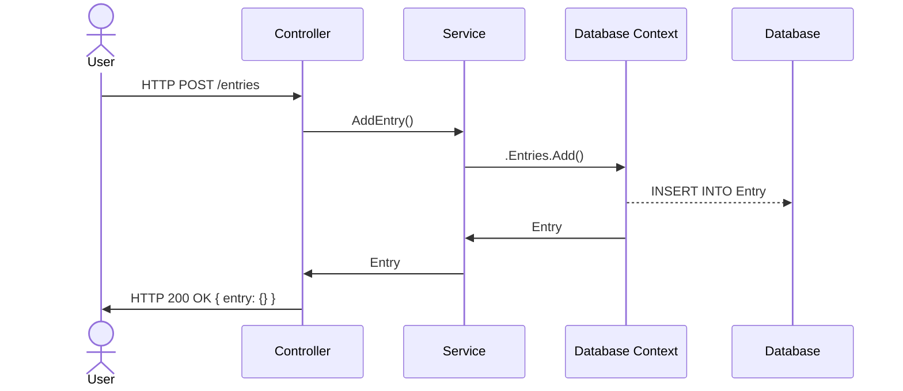
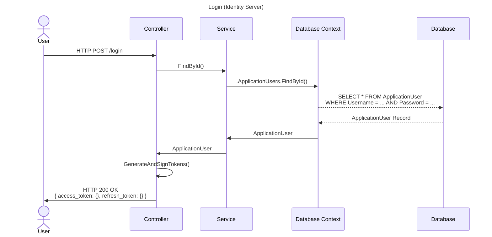
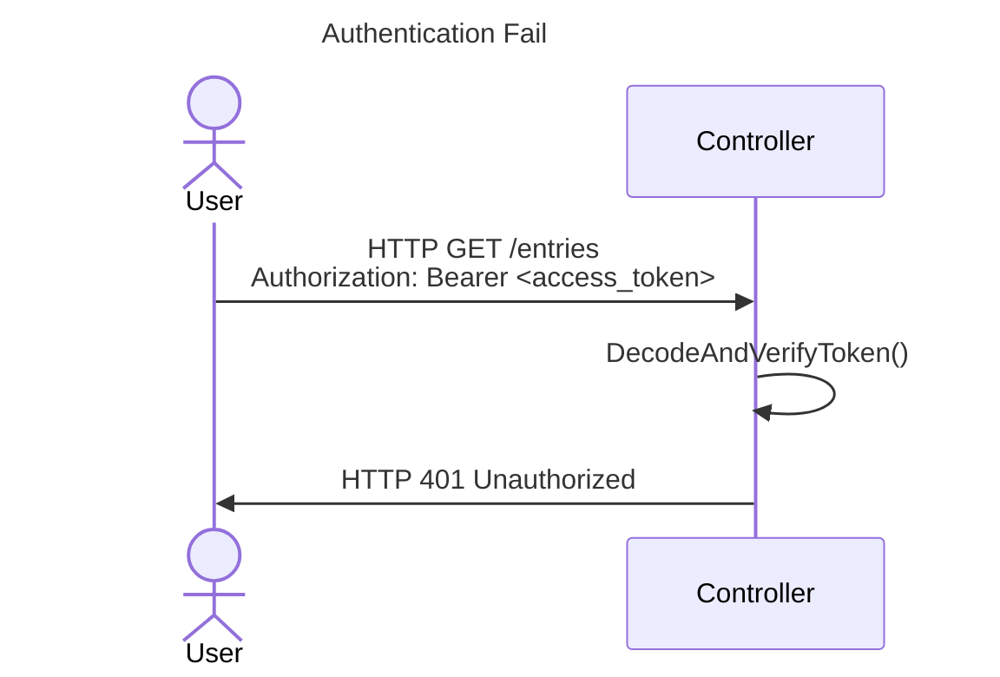
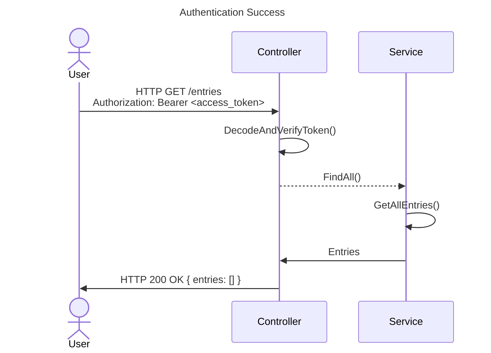
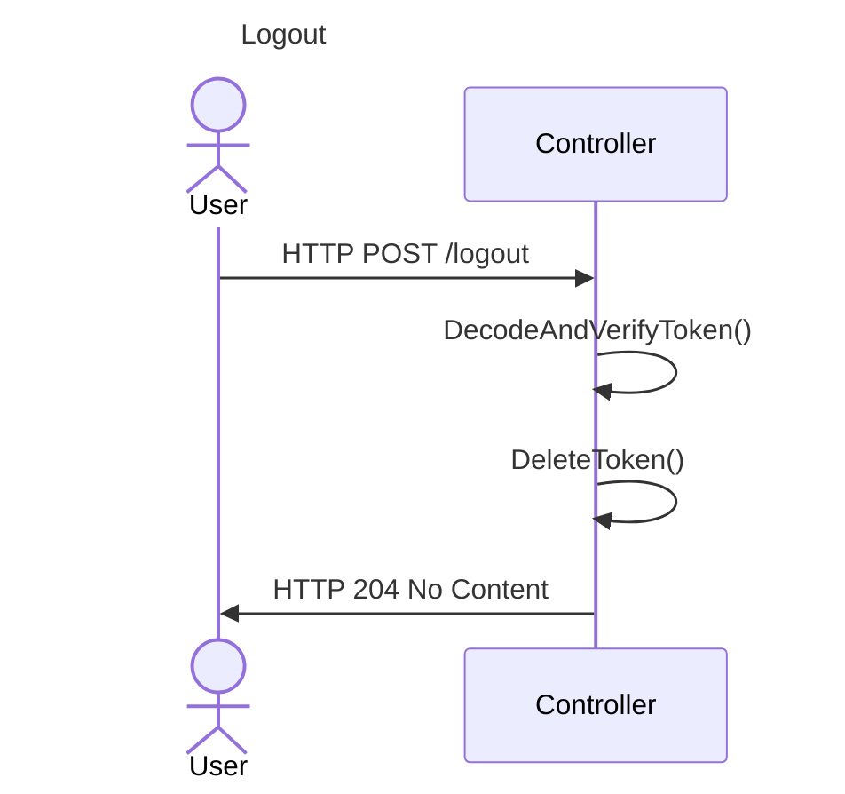

# Datenbank
Die Daten werden in einer PostgreSQL-Datenbank gespeichert. In der Entwicklungsumgebung wird diese in der docker-compose-yml konfiguriert.

## Datenbankadministration
Über http://localhost:5050 ist PgAdmin4 erreichbar. Damit lässt sich die Datenbank komfortabel verwalten. Der Benutzername lautet zli@example.com und das Passwort zli*123. Die Verbindung zur PostgreSQL-Datenbank muss zuerst mit folgenden Daten konfiguriert werden:

* Host name/address: db
* Port: 5432
* Maintenance database: postgres
* Username: postgres
* Password: postgres

## UML Anwendungsfalldiagramm

```mermaid
usecase-beta
    actor User("User")
    systemBoundary punchClock["Punch Clock"]
        Request("Get all entries from DB")
        Create("Add new entry in DB")
    end
    json Entry@{
        "id": 42,
        "checkin": "2023-01-01T12:00:00",
        "checkout": "2023-01-01T18:30:00"
    }
    User requests@-- "requests all entries" ---> Request
    User adds@-- "adds new entry" --> Create
    Create --> Entry
```

## UML Klassendiagramm



## ERD



## Sequenzdiagramme













## Unit Tests

**Test Cases für den** `TimeSummaryService`

`List<object> CalculateSummaryPerDay(List<Entry> entries)`

|Name|Entries|Erwartetes Resultat|
|-|-|-|
|`NoEntriesProvided_ReturnsEmptyList`|`[]`|`[]`|
|`OneEntry_CheckoutIsBeforeCheckin_ThrowsArgumentException`|`[{"checkin":"02-11-2026T16:30:00.0000", "checkout": "02-11-2026T10:30:00.0000"}]`|`ArgumentException(nameof(entries))`|
|`OneEntry_CheckoutIsOnNextDay_ReturnsUntilAndFromMidnight`|`[{"checkin":"02-11-2026T16:30:00.0000", "checkout": "03-11-2026T10:30:00.0000"}]`|`[{"02-11-2026": "07:30:00"}, {"03-11-2026": "10:30:00"}]`|
|`OneEntry_MinAndMaxValue_ThrowsArgumentOutOfRangeException`|`[{"checkin":"01-01-0001T00:00:00.0000", "checkout": "31-12-9999T23:59:59.9999"}]`|`ArgumentOutOfRange(nameof(entries))`|
|`OneEntry_LessThanASecond_ThrowsArgumentException`|`[{"checkin":"29-06-2023T14:30:00.0000", "checkout": "29-06-2023T14:30:00.0001"}]`|`ArgumentException(nameof(entries))`|
|`OneEntry_UnevenTime_IsRoundedToTheNextSecond`|`[{"checkin":"23-05-2019T05:10:00.0000", "checkout": "23-05-2019T05:13:00.9999"}]`|`[{"23-05-2019": "00:03:01"}]`|
|`TwoEntries_EntriesOverlap_ThrowsArgumentException`|`[{"checkin":"02-11-2026T16:30:00.0000", "checkout": "02-11-2026T18:42:15.0000"}, {"checkin":"02-11-2026T17:10:00.0000", "checkout": "02-11-2026T20:00:50.0000"}]`|`ArgumentException(nameof(entries))`|
|`MultipleEntries_ReturnsCorrectTimes`|`[{"checkin":"02-11-2026T08:32:00.0000", "checkout": "02-11-2026T12:01:00.0000"}, {"checkin":"03-11-2026T13:00:00.0000", "checkout": "03-11-2026T17:45:00.0000"}, {"checkin":"01-04-2026T10:00:00.0000", "checkout": "01-04-2026T16:15:00.0000"}]`|`[{"02-11-2026": "03:29:00"}, {"03-11-2026": "04:45:00"}, {"01-04-2026": "06:15:00"}]`|
