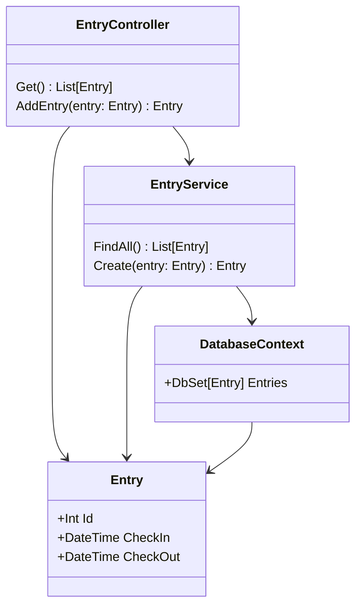
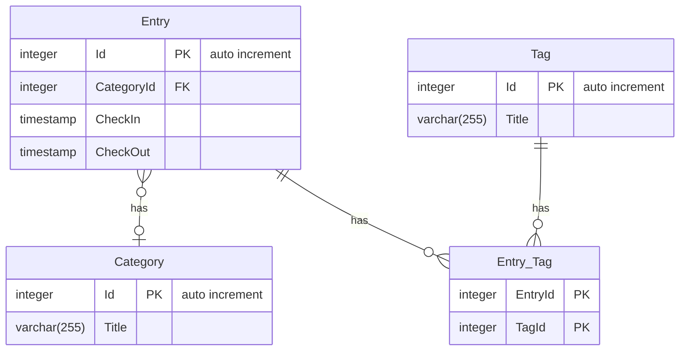
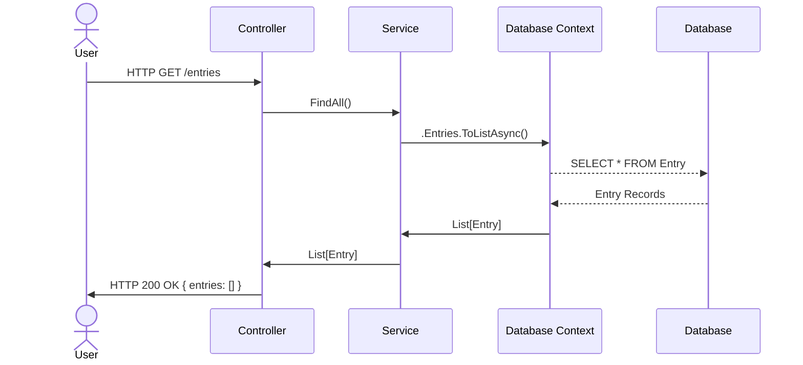
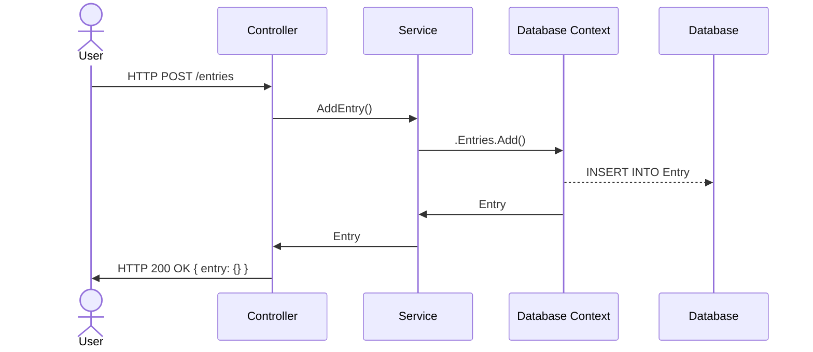

# Datenbank
Die Daten werden in einer PostgreSQL-Datenbank gespeichert. In der Entwicklungsumgebung wird diese in der docker-compose-yml konfiguriert.

## Datenbankadministration
Über http://localhost:5050 ist PgAdmin4 erreichbar. Damit lässt sich die Datenbank komfortabel verwalten. Der Benutzername lautet zli@example.com und das Passwort zli*123. Die Verbindung zur PostgreSQL-Datenbank muss zuerst mit folgenden Daten konfiguriert werden:

* Host name/address: db
* Port: 5432
* Maintenance database: postgres
* Username: postgres
* Password: postgres

## UML Anwendungsfalldiagramm

```mermaid
usecase-beta
    actor User("User")
    systemBoundary punchClock["Punch Clock"]
        Request("Get all entries from DB")
        Create("Add new entry in DB")
    end
    json Entry@{
        "id": 42,
        "checkin": "2023-01-01T12:00:00",
        "checkout": "2023-01-01T18:30:00"
    }
    User requests@-- "requests all entries" ---> Request
    User adds@-- "adds new entry" --> Create
    Create --> Entry
```

## UML Klassendiagramm



## ERD



## Sequenzdiagramme




